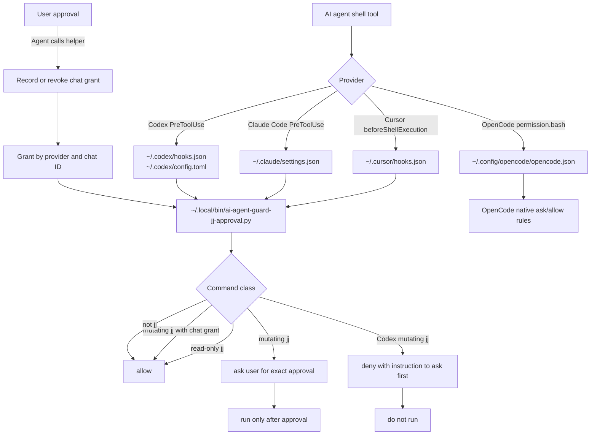

# AI Agent Jujutsu Approval

AI agents must ask before running mutating Jujutsu commands. Human shell usage is unchanged: this is not a `jj` wrapper and does not intercept manual commands.

## What Is Protected

Read-only inspection is allowed without prompting: `jj status`, `jj diff`, `jj log`, `jj show`, `jj op log`, `jj config list`, and equivalent local aliases.

Everything that can commit, move the working copy, rewrite history, change bookmarks, abandon work, undo, or push requires approval. Examples: `jj commit`, `jj new`, `jj edit`, `jj next`, `jj prev`, `jj rebase`, `jj squash`, `jj absorb`, `jj abandon`, `jj undo`, `jj bookmark set`, and `jj git push`.

## Chat Bypass

In Cursor, Claude Code, or Codex, grant the bypass in any user prompt. For example, say "Prepare the commit and you can bypass jj hooks." The grant covers all Jujutsu writes in that chat, including pushes. A normal approval prompt still covers one operation.

The agent records approval with the standalone helper `~/.local/bin/ai-agent-guard-jj-approval.py --provider <provider> --session-action grant`. The tool hook supplies the chat ID. Ask the agent to revoke approval to restore per-operation checks.

The helper creates an empty file under `$XDG_STATE_HOME/ai-agent-jj-approval` (default `~/.local/state/ai-agent-jj-approval`). The file name is a hash of the provider and chat ID. The shell hook checks this file before asking or blocking a write. A resumed chat keeps its grant if the provider reuses its ID. Subagents share the grant only if the provider supplies the same chat ID.

## Architecture



## Files

| Path                                  | Role                                                              |
|---------------------------------------|-------------------------------------------------------------------|
| `AI/agent-guards/jj-approval.py`      | Shared classifier and provider response adapter                   |
| `AI/agent-guards/install.py`          | Idempotently installs/merges active user-level agent config       |
| `nix/home/tools.nix`                  | Home Manager activation step that runs `install.py` on every switch |
| `AI/.cursor/rules/jj-ai-approval.mdc` | Cursor instruction rule source                                    |
| `AI/.cursor/hooks.json`               | Versioned Cursor hook template                                    |
| `AI/tests/test_jj_approval_guard.py`  | Guard behavior tests                                              |

## Provider Behavior

Cursor and Claude Code can ask the user from pre-execution hooks, so mutating `jj` commands become approval prompts.

Codex `PreToolUse` denies mutating `jj` commands by default and points to the chat bypass. Once granted, the guard lets the command proceed to Codex's normal sandbox and approval checks.

OpenCode uses native `permission.bash` rules: `jj *` asks by default, with explicit allow rules for read-only `jj` commands.

## Installation

`nix/home/tools.nix` runs `AI/agent-guards/install.py` on every `home-manager
switch`, so this is set up as part of the normal Nix bootstrap
(`nix/bootstrap.sh`). It creates the `~/.local/bin/ai-agent-guard-jj-approval.py`
symlink and merges provider config without overwriting unrelated settings.

Manual re-run:

```sh
AI/agent-guards/install.py
```

For Windows Codex Desktop with a WSL shell, run the installer from WSL with
`--windows-codex-home <mounted Windows .codex path> --wsl-distro <distro name>`.
Review the new hook in Codex before use.

## Verification

```sh
python3 AI/tests/test_jj_approval_guard.py
```

The tests check default behavior, chat and provider isolation, and revocation.
